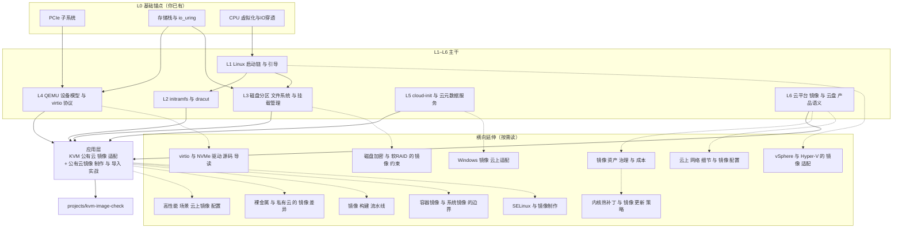

# 公有云镜像适配 学习路径

> 这是一张**导航图**：告诉你在这一块"先读什么、再读什么、每层要动手验什么、能答上什么就可以跳过"。
> 应用落点是 [[concepts/KVM 公有云 镜像 适配]] 与其配套的 [[entities/公有云镜像 制作 与 导入 实战]]、`projects/kvm-image-check/`。

## 0. 怎么用这份路径

三条路径，按目的选：

| 路径 | 适用场景 | 走哪几层 |
|---|---|---|
| **A 最小闭环** | 只解决手头的镜像上云问题（能起来、能注入、能扩容） | L1 → L2 → L3 → 应用层 |
| **B 完整补全**（推荐） | 想真正掌握这块、以后自己排障与出图 | L0 → L1 → L2 → L3 → L4 → L5 → L6 → 应用层 |
| **C 深潜** | 想搞清"为什么"、读到协议与源码级 | B 之上加 L4 的协议细节与内核源码路径（virtio_blk.c / nvme / dracut 脚本） |

**读法**：每层先看"目标"和"自测"，能答上自测题就直接跳到下一层（避免重复学已会的）。
每层都必须**动手**——这块知识全靠"破坏一次再修好"才能记住。

## 1. 分层地图

```
                        应用层：镜像适配与出图
     ┌──────────────────────────────────────────────────────────┐
     │ KVM 公有云 镜像 适配  ←→  公有云镜像 制作 与 导入 实战     │
     │                 projects/kvm-image-check                 │
     └──────────────────────────────────────────────────────────┘
             ▲              ▲              ▲              ▲
             │              │              │              │
   L6 云平台产品语义   L5 cloud-init    L4 设备模型      L3 分区/FS/挂载
   镜像 与 云盘 产品语义  与 云元数据服务  与 virtio 协议   磁盘分区 文件系统 与 挂载管理
             ▲              ▲              ▲              ▲
             └──────────────┴──────────────┴──────────────┘
                                    ▲
                          L2 initramfs 与 dracut
                                    ▲
                          L1 Linux 启动链 与 引导
                                    ▲
             ┌──────────────────────┴──────────────────────┐
        L0 基础锚点（你已有）
   PCIe 子系统 │ 存储栈与io_uring │ CPU 虚拟化与IO穿透 │ Linux 内存管理
```

### 1.1 关系图谱（Obsidian 中直接渲染）



> 实线 = 主干依赖（下层是上层的"为什么"），虚线 = 横向延伸。图中每个节点都是本库的一张页。

**依赖关系**：下层是上层的"为什么"。排障时从应用层往下找断点，学习时从下往上建认知。

## 2. L0 基础锚点（你可能已有，用来自检）

| 页面 | 为什么它是这块的基础 |
|---|---|
| [[concepts/PCIe 子系统]] | virtio 设备与 NVMe 控制器在 guest 里都是 PCIe 设备；BDF/配置空间/BAR/MSI-X 是后续一切的地基 |
| [[concepts/存储栈与io_uring]] | bio→request→设备队列的路径；NVMe 队列模型与中断亲和（你已从性能视角建过） |
| [[concepts/CPU 虚拟化与IO穿透]] | VT-x/VT-d、IOMMU、VFIO：理解"host 怎么把设备交给 guest" |
| [[concepts/Linux 内存管理]] | initramfs 展开到 tmpfs、页缓存与回写对镜像 IO 的影响 |

**自测**：你能说清"一次 guest 内的 write() 到云盘，中间经过哪些层"吗？（VFS → FS → 块层 → 驱动 → virtqueue/NVMe 队列 → host 侧后端）
能说清就可跳过 L0。

## 3. L1 启动链（**建议起点**）

| 项 | 内容 |
|---|---|
| **目标** | 能定位"起不来"断在哪一环；理解 UEFI 与 Legacy 的本质差异 |
| **必读** | [[concepts/Linux 启动链 与 引导]] |
| **关键认知** | ① 固件→GPT/ESP→shim/GRUB→kernel+initramfs→systemd 的顺序 ② Legacy 写死在盘上、UEFI 登记在 NVRAM ③ RHEL8 两个 grub.cfg 的 stub 机制 ④ 云端 NVRAM 为空 → 只能走 `\EFI\BOOT\BOOTX64.EFI` |
| **动手** | `ls /sys/firmware/efi`；`efibootmgr -v`；`head -5 /boot/efi/EFI/redhat/grub.cfg`；**做 §8 破坏实验单**（只删 fallback → 仍能起；再删 NVRAM → 起不来；三条救援路径） |
| **自测** | ① Legacy/UEFI 引导代码分别在哪 ② 为什么云上必须依赖 fallback 路径 ③ emergency mode 属于哪一环 |
| **学完能回答** | "为什么本地能起、上云起不来"的第一层答案 |

**为什么从这里开始**：它是树根 —— 你这次踩的坑（`root=` 非 UUID、ESP fallback 缺失、kernel panic）全在它的下游。

## 4. L2 initramfs 与 dracut

| 项 | 内容 |
|---|---|
| **目标** | 理解"驱动为什么必须打进 initramfs"，并能自己重建与验证 |
| **必读** | [[concepts/initramfs 与 dracut]] |
| **关键认知** | ① 挂根需要驱动、驱动在根上 → initramfs 破悖论 ② 它是 **cpio 归档**不是文件系统 ③ hostonly 模式是跨硬件/跨云的坑 ④ RHEL8 可能是"未压缩微码段 + 压缩主段"拼接 ⑤ 手工 dracut 的成果会被内核升级冲掉 |
| **动手** | `lsinitrd \| grep -E 'virtio\|nvme'`；**用 `--omit-drivers` 造一个缺驱动的 initramfs 复现 panic，再修回**；写 `/etc/dracut.conf.d/virtio.conf` 固化 |
| **自测** | ① initramfs 破的是什么悖论 ② hostonly 为什么踩坑 ③ rd.break 与 rd.shell 区别 |
| **学完能回答** | "为什么加了驱动还是起不来 / 为什么升级内核后又起不来" |

## 5. L3 分区 / 文件系统 / 挂载

| 项 | 内容 |
|---|---|
| **目标** | 能独立设计一个"云友好"的分区布局，并解释每条规范约束的成因 |
| **必读** | [[concepts/磁盘分区 文件系统 与 挂载管理]] |
| **关键认知** | ① GPT 类型码（ESP=ef00、bios_grub=ef02） ② **根分区放最后** 的因果（growpart 只能扩末尾） ③ XFS 只扩不缩、扩容命令与 ext4 不同 ④ fstab **`nofail` ≠ `noauto`**，systemd 把 fstab 翻成 mount 单元 ⑤ LVM 让扩容从 2 步变 5 步 |
| **动手** | 手工做一次 GPT+ESP+/boot+根在末尾的布局；`growpart`+`xfs_growfs` 扩一次；**造一条挂不存在设备的 fstab 复现 emergency，再用 nofail 修** |
| **自测** | ① 根分区为什么必须在末尾 ② 分区 UUID 与文件系统 UUID 区别 ③ LVM 为何被规范禁 |
| **学完能回答** | 原理页 §3 那张规范表里几乎每一行的"为什么" |

## 6. L4 QEMU 设备模型 与 virtio 协议

| 项 | 内容 |
|---|---|
| **目标** | 从"记结论"升级到"能推"：为什么三种挂载形态对应三种驱动与设备名 |
| **必读** | [[concepts/QEMU 设备模型 与 virtio 协议]] |
| **深潜（路径 C）** | [[concepts/virtio 与 NVMe 驱动 源码 导读]]（virtio_blk / virtio_scsi / nvme 驱动结构、Sysfs 反查、请求路径观测） |
| **关键认知** | ① KVM 不提供设备，设备由 QEMU 模拟 ② virtqueue 三环（desc/avail/used）与通知抑制 ③ virtio 设备 ID（2=block、8=scsi）、modern(0x1040+n)/legacy(0x1000+n) ④ virtio-scsi 走 SCSI 中层、NVMe 云盘用标准 NVMe 驱动 ⑤ OVMF 的 VARS 文件 ≈ 云上 NVRAM |
| **动手** | 用 §4 的四条命令行各起一次；`lspci -nn \| grep -i virtio`；`ls -l /sys/block/*` 对照设备名 |
| **自测** | ① virtqueue 三个环谁写谁读 ② virtio-scsi 与 virtio-blk 驱动栈差异 ③ NVMe 云盘为什么不需要 guest 知道被虚拟化 |
| **学完能回答** | 三种挂载形态的性能与语义差异，以及云厂商换设备对镜像的影响 |

## 7. L5 cloud-init 与元数据服务

| 项 | 内容 |
|---|---|
| **目标** | 理解"实例一次性初始化"的机制，并能排查注入失败 |
| **必读** | [[concepts/cloud-init 与 云元数据服务]] |
| **关键认知** | ① instance-id 驱动的一次性语义与克隆陷阱 ② 四阶段（init-local/init/config/final） ③ datasource：ConfigDrive vs 元数据服务 ④ `/var/lib/cloud` 状态清理 ⑤ IMDS 加固模式与 SSRF |
| **动手** | 起一台实例跑 `cloud-init status --long` / `analyze show` / `query -a`；清 `/var/lib/cloud` 观察是否重跑；`curl` 元数据地址 |
| **自测** | ① 克隆镜像为什么可能导致不初始化 ② 开机卡 1~2 分钟是哪个环节 ③ cloud-init 与各类 agent 的分工 |

## 8. L6 云平台产品语义 与 工具链

| 项 | 内容 |
|---|---|
| **目标** | 看懂平台契约边界，知道每个导入参数"填错的后果" |
| **必读** | [[concepts/云平台 镜像 与 云盘 产品语义]]、[[entities/镜像格式 与 离线处理工具链]] |
| **关键认知** | ① 规格代际 → 固件/协议要求（隐性门槛） ② 系统盘选 100 GiB ≠ 根分区 100 GiB ③ 快照/镜像/备份三者语义 ④ 自定义镜像生命周期与导入参数后果表 ⑤ qcow2/virt-customize/libguestfs 三件套 |
| **动手** | `qemu-img info/convert/check`；`virt-customize` 改一次镜像；`qemu-nbd` 挂一次盘；把同一镜像导入两家云并对比参数 |
| **自测** | ① 为什么 g6→g8i 可能起不来 ② 快照能直接启动吗 ③ 跨云为什么不能直接复制镜像 |

## 9. 应用层：把上面全部串起来

| 项 | 内容 |
|---|---|
| **入口** | [[concepts/KVM 公有云 镜像 适配]]（原理与规范）+ [[entities/公有云镜像 制作 与 导入 实战]]（操作手册） |
| **工具** | `projects/kvm-image-check/`（29 项自检、离线模式、fixture 测试） |
| **闭环** | 出图 → 离线自检 → 本地四种挂法验证 → 导入 → 云上规格验收（原理页 §12） |

## 10. 自测总表（答案要点）

| # | 问题 | 答案要点 |
|---|---|---|
| 1 | Legacy 与 UEFI 引导代码在哪？为什么只有 UEFI 要 ESP？ | MBR 前 446B+空隙 / ESP 内的 .efi；UEFI 固件认识 FAT 并读文件 |
| 2 | `/boot/efi/EFI/redhat/grub.cfg` 为什么没 menuentry？ | 它是 stub（search+set prefix），真配置在 `/boot/grub2/grub.cfg` |
| 3 | 本地 efibootmgr 引导项为何上云失效？ | 引导项存在本地 NVRAM，云上 NVRAM 为空 → 退化到 `\EFI\BOOT\BOOTX64.EFI` |
| 4 | initramfs 破什么悖论？ | 挂根要驱动、驱动在根上 → 内核先展开 cpio 到 tmpfs |
| 5 | hostonly 为什么跨云踩坑？ | 只收本机用到的模块，存储协议不同就找不到根盘 |
| 6 | 根分区为何必须放最后？ | `growpart` 只能扩分区表末尾分区 |
| 7 | `nofail` 与 `noauto`？ | nofail=试挂但失败不阻塞；noauto=启动时不挂 |
| 8 | 分区 UUID vs 文件系统 UUID？ | PARTUUID 属分区表；fstab/grub 用文件系统 UUID（跟数据走） |
| 9 | virtqueue 三环？ | descriptor table + avail ring（guest→host）+ used ring（host→guest） |
| 10 | virtio-scsi 与 virtio-blk 驱动栈差异？ | scsi 走 `scsi_mod`/`sd_mod` 完整 SCSI 中层；blk 直连块层 |
| 11 | 克隆镜像为何可能不初始化？ | instance-id 未变 + `/var/lib/cloud` 状态未清 → 判定已初始化 |
| 12 | 系统盘选 100 GiB 但 df 没变？ | 只做了 host 侧扩容，需 growpart/resizefs（cloud-init 通常自动） |
| 13 | LVM 为什么被规范禁？ | growpart 打不穿两层映射，cloud-init 不会替你 pvresize/lvextend |
| 14 | 快照 vs 镜像？ | 快照是盘维度（不可直接启动），镜像是可引导系统模板 |
| 15 | 跨云为何不能直接复制镜像？ | 格式/分区/驱动/启动模式契约不同 → 各自导出再导入，或用迁移工具 |

## 11. 与既有强项的迁移关系（你不需要从零的地方）

你这块已有的沉淀可以直接复用，别重复投入：

| 你已掌握的 | 直接迁移到本主题 |
|---|---|
| PCIe 枚举 / BDF / MSI-X 亲和 | 理解 virtio 与 NVMe 控制器在 guest 的出现方式、`lspci`/`/sys/block` 对照 |
| SR-IOV / VFIO / IOMMU | 理解"直通 vs 半虚拟化"的性能与部署差异；对比 virtio-net 与 DPDK PMD |
| 中断亲和 / 队列深度 / io scheduler | 云盘性能调优与 `none` 调度器选择（接 [[concepts/存储栈与io_uring]]） |
| 带论断求证的工作方式 | 本主题里"阿里云不支持 NVMe"就是典型待核论断 —— 结论是**按规格代际分叉**，不是协议站队 |

## 12. 扩展方式（以后怎么往这张图里加内容）

- **新页挂接**：写到某个层时，更新本页对应小节 + `索引.md` 的「虚拟化与公有云镜像」章节
- **新增层的判断标准**：当出现"反复要解释、且已有页放不下"的概念时，独立成页（本批 6 张概念页就是这么来的）
- **剩余缺口**（本主题主干已闭环；以下属"需要时再查"或"超出本主题"）：
  - **Kickstart / anaconda 自动化应答深化**（当前 Packer 页仅一行 `inst.ks`；真要产线重铸时展开）
  - **云上数据盘"初始化 + 自动挂载"完整闭环**（当前分散在 fstab/nofail 与数据盘语义两处）
  - 安全加固基线细节（auditd 规则、密码策略等）——属安全加固主题，不在镜像适配主线
- **复效周期**：L3 规范约束与 L6 产品语义最易过时，每半年或每次出图前复核（复核清单见 [[concepts/KVM 公有云 镜像 适配]] §15 末）

## 13. 横向延伸：相邻但独立的问题

这几块**不属于本主题主线**，但做镜像/上云时一定会碰到，已各自成页：

| 主题 | 页面 | 什么时候需要 |
|---|---|---|
| 高性能 / 数据面场景（DPDK 大页、绑核、vfio、云上拿不到直通网卡） | [[entities/高性能 场景 云上镜像 配置]] | appliance 是数据面设备时必须读 |
| SELinux 与镜像制作 | [[concepts/SELinux 与 镜像制作]] | 离线改镜像 / enforcing / 等保加固 |
| Windows 镜像适配 | [[concepts/Windows 镜像 云上适配]] | 交付含 Windows 的场景 |
| 容器镜像 vs 系统镜像 | [[concepts/容器镜像 与 系统镜像 的边界]] | 判断"该交付哪一种"、bootc 类新范式 |
| 镜像构建流水线 | [[entities/镜像 构建 流水线]] | 从手工出图升级为可重复构建（产线） |
| **裸金属（BMS）与私有云（OpenStack）** | [[concepts/裸金属 与 私有云 的 镜像 差异]] | **交付到客户现场（非公有云）** |
| **vSphere 与 Hyper-V** | [[concepts/vSphere 与 Hyper-V 的 镜像 适配]] | **交付到 VMware / Hyper-V 环境（virt-v2v 派生）** |
| 磁盘加密与软 RAID | [[concepts/磁盘加密 与 软RAID 的 镜像 约束]] | 合规要求加密存储 / 想用 RAID 提性能 |
| 云上网络细节（IPv6 / MTU / DNS / 多网卡） | [[concepts/云上 网络 细节 与 镜像 配置]] | 双栈、巨帧、多网卡分离场景 |
| **镜像资产治理与成本** | [[concepts/镜像 资产 治理 与 成本]] | 多版本运维、回滚、签名、账面对齐 |
| **内核热补丁与更新策略** | [[concepts/内核热补丁 与 镜像 更新 策略]] | CVE 应急窗口、等保要求"修复可验证" |
| 驱动源码深潜 | [[concepts/virtio 与 NVMe 驱动 源码 导读]] | 路径 C |

## 相关

- [[concepts/KVM 公有云 镜像 适配]] — 本主题主页面（原理与规范）
- [[entities/公有云镜像 制作 与 导入 实战]] — 操作手册
- [[entities/镜像格式 与 离线处理工具链]] — 工具与离线处理
- [[concepts/Linux 启动链 与 引导]] / [[concepts/initramfs 与 dracut]] / [[concepts/磁盘分区 文件系统 与 挂载管理]] / [[concepts/QEMU 设备模型 与 virtio 协议]] / [[concepts/cloud-init 与 云元数据服务]] / [[concepts/云平台 镜像 与 云盘 产品语义]]
- 横向延伸：[[entities/高性能 场景 云上镜像 配置]]、[[concepts/SELinux 与 镜像制作]]、[[concepts/Windows 镜像 云上适配]]、[[concepts/容器镜像 与 系统镜像 的边界]]、[[entities/镜像 构建 流水线]]、[[concepts/裸金属 与 私有云 的 镜像 差异]]、[[concepts/vSphere 与 Hyper-V 的 镜像 适配]]、[[concepts/磁盘加密 与 软RAID 的 镜像 约束]]、[[concepts/云上 网络 细节 与 镜像 配置]]、[[concepts/镜像 资产 治理 与 成本]]、[[concepts/内核热补丁 与 镜像 更新 策略]]、[[concepts/virtio 与 NVMe 驱动 源码 导读]]
